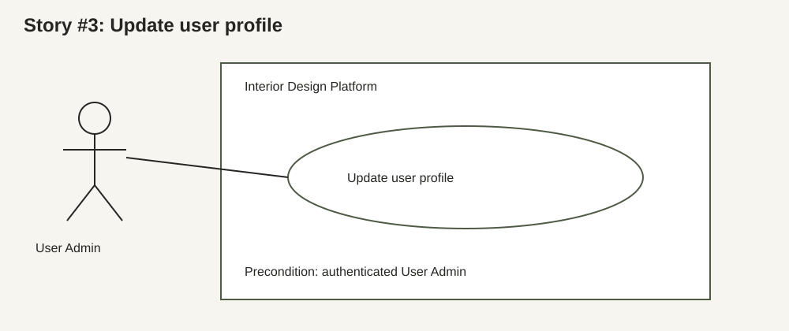
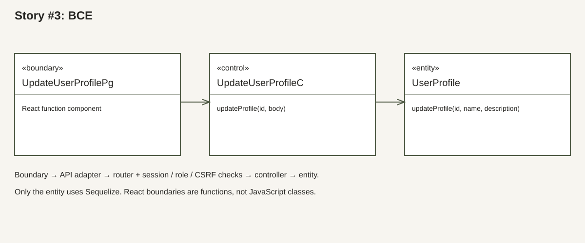
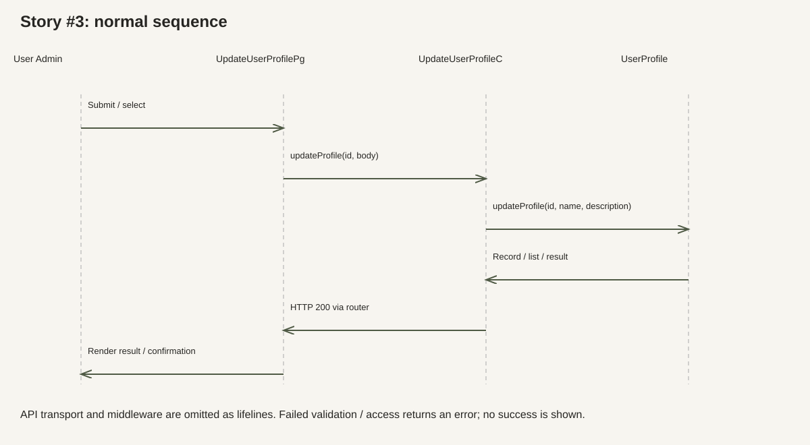

# Story #3: Update user profile

Owner: Christy. Actor: User Admin. Sprint 1+2.

Source: uploaded `CSIT314_Project_Plan (1).xlsx`, Story Checklist row 15; Features rows 10–11. These descriptions document the current implementation. Input limits and duplicate handling follow the existing code; they are not new tutor-approved requirements.

## Use case diagram

## Use case description

Goal: update user profile in the Interior Design Platform.

Preconditions: an active account and profile, a valid server session with role `User Admin` and an existing selected record.

Trigger: the actor selects update.

### Normal flow

1. The User Admin opens the update page for an existing record.
2. The page loads the current values.
3. They edit name or description and submit.
4. The API checks the session, role and CSRF token.
5. The controller validates the ID and fields; the entity updates the record.
6. The boundary opens the details and confirms the update.

### Alternative flows

- No session: 401; the shared client ends a protected session and the guard opens login.
- Wrong role: 403; no record is changed.
- Database/network failure: show an error and allow retry; do not show success.
- Missing or wrong CSRF token, or untrusted Origin: 403; no mutation.
- Blank/non-text name, name over 255 characters, or invalid description: 400 and field errors; preserve entered values.
- Duplicate name: 409 and a name error; preserve the original record.
- Invalid positive integer ID: 400. Valid ID with no record: 404.

Postcondition: the normal flow completes with HTTP 200; failed validation or access does not apply the requested change. Reads leave data unchanged.

## BCE class diagram

Boundary: `client/src/boundary/UpdateUserProfilePg.jsx`. Controller: `server/src/controller/UpdateUserProfileC.js`. Entity: `server/src/entity/UserProfile.js`.

The BCE diagram shows logical boundary/control/entity roles. Boundaries use React hooks and shared UI components; diagrams do not invent JavaScript classes or methods. Create/update boundaries define `displaySuccess()` and `displayError()`. View/search use `DetailsView`, `ResultsTable` and `RecordLoadState`; confirmation errors are handled by `ConfirmAction`.

## Sequence diagram

API: `PUT /api/user-profiles/:id`. The boundary calls `api`, which carries the session cookie and CSRF token. The router invokes `UpdateUserProfileC.updateProfile(id, body)`; the controller invokes `UserProfile.updateProfile(id, name, description)`.

## Test cases and automated checks

1. Valid edits → 200; preserve ID and links and status.
2. Invalid/duplicate edit → 400/409; preserve old fields.
3. Missing ID → 404.

Access cases for every route: anonymous → 401; another role → 403. Mutation cases: missing/wrong CSRF or untrusted Origin → 403; authorized owner with a valid token → normal flow. See `server/tests/christyAuthorization.test.js` and `server/tests/userProfiles.test.js`.

Manual UI cases still to record: complete the normal flow; preserve values after an error; cancel a confirmation; keyboard-only use and focus restoration; phone-width layout; retry a failed load. Live-site deployment has not been checked in this run.

## Evidence status

The feature code and tests existed before this run. Historical TDD screenshots cannot be reconstructed. This run added and ran 16 authorization integration tests before mounting the feature routers: all 16 failed (404). After integration, the full server suite passed (110 tests). This is integration evidence, not proof that the original feature used TDD.

The Supabase migration is prepared in `docs/christy-schema.sql` and has not been applied. PR merge, remote CI, live deployment and lab evidence remain pending.
