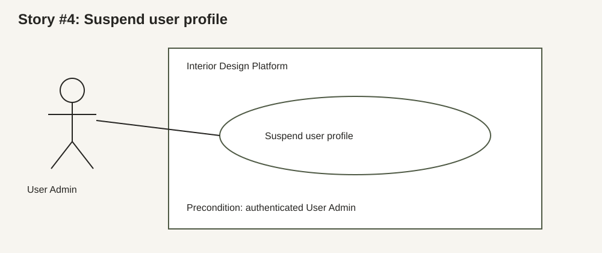
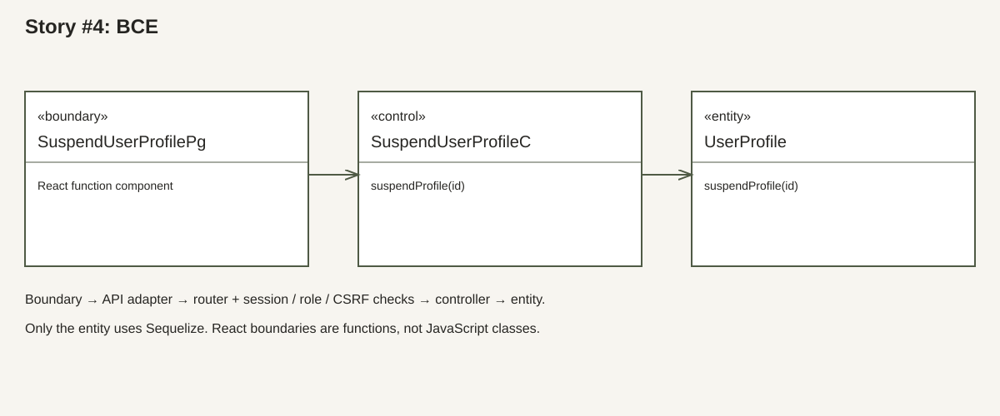
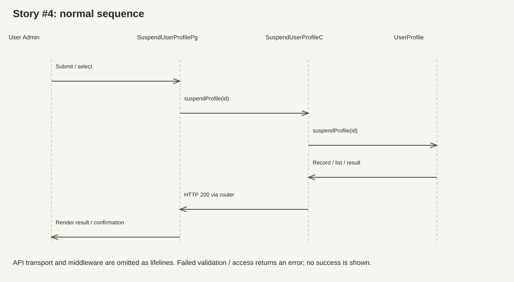

# Story #4: Suspend user profile

Owner: Christy. Actor: User Admin. Sprint 1+2.

Source: uploaded `CSIT314_Project_Plan (1).xlsx`, Story Checklist row 16; Features rows 10–11. These descriptions document the current implementation. Input limits and duplicate handling follow the existing code; they are not new tutor-approved requirements.

## Use case diagram

## Use case description

Goal: suspend user profile in the Interior Design Platform.

Preconditions: an active account and profile, a valid server session with role `User Admin` and an existing selected record.

Trigger: the actor selects suspend.

### Normal flow

1. The User Admin selects Suspend for an active profile.
2. The page loads its name and status.
3. They open the confirmation dialog and confirm.
4. The API checks the session, role and CSRF token.
5. The entity sets status to suspended and preserves the profile and account links.
6. The page confirms the action; subsequent protected requests and logins for that profile are refused.

### Alternative flows

- No session: 401; the shared client ends a protected session and the guard opens login.
- Wrong role: 403; no record is changed.
- Database/network failure: show an error and allow retry; do not show success.
- Missing or wrong CSRF token, or untrusted Origin: 403; no mutation.
- Invalid positive integer ID: 400. Valid ID with no record: 404.
- Cancel or Escape before confirming: close the dialog without sending the mutation; focus returns to the trigger.
- Already suspended: the UI disables Suspend; a direct repeated request returns the suspended record (200).

Postcondition: the normal flow completes with HTTP 200; failed validation or access does not apply the requested change. Reads leave data unchanged.

## BCE class diagram

Boundary: `client/src/boundary/SuspendUserProfilePg.jsx`. Controller: `server/src/controller/SuspendUserProfileC.js`. Entity: `server/src/entity/UserProfile.js`.

The BCE diagram shows logical boundary/control/entity roles. Boundaries use React hooks and shared UI components; diagrams do not invent JavaScript classes or methods. Create/update boundaries define `displaySuccess()` and `displayError()`. View/search use `DetailsView`, `ResultsTable` and `RecordLoadState`; confirmation errors are handled by `ConfirmAction`.

## Sequence diagram

API: `POST /api/user-profiles/:id/suspend`. The boundary calls `api`, which carries the session cookie and CSRF token. The router invokes `SuspendUserProfileC.suspendProfile(id)`; the controller invokes `UserProfile.suspendProfile(id)`.

## Test cases and automated checks

1. Suspend → 200; preserve accounts and profile, block login.
2. Repeat → 200; missing ID → 404.
3. Existing manager session → 401 after profile suspension.

Access cases for every route: anonymous → 401; another role → 403. Mutation cases: missing/wrong CSRF or untrusted Origin → 403; authorized owner with a valid token → normal flow. See `server/tests/christyAuthorization.test.js` and `server/tests/userProfiles.test.js`.

Manual UI cases still to record: complete the normal flow; preserve values after an error; cancel a confirmation; keyboard-only use and focus restoration; phone-width layout; retry a failed load. Live-site deployment has not been checked in this run.

## Evidence status

The feature code and tests existed before this run. Historical TDD screenshots cannot be reconstructed. This run added and ran 16 authorization integration tests before mounting the feature routers: all 16 failed (404). After integration, the full server suite passed (110 tests). This is integration evidence, not proof that the original feature used TDD.

The Supabase migration is prepared in `docs/christy-schema.sql` and has not been applied. PR merge, remote CI, live deployment and lab evidence remain pending.
