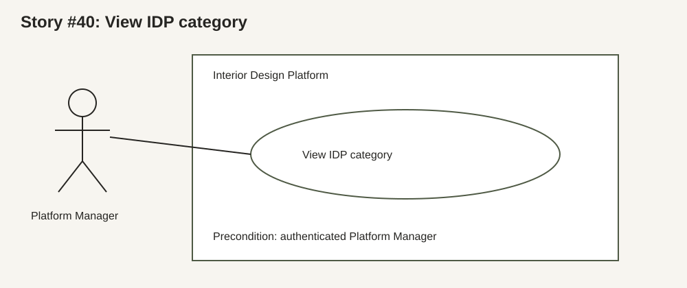
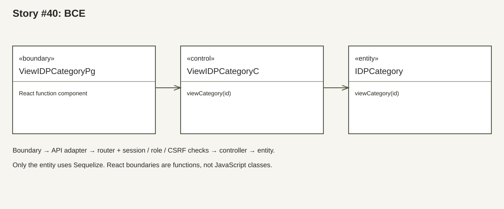
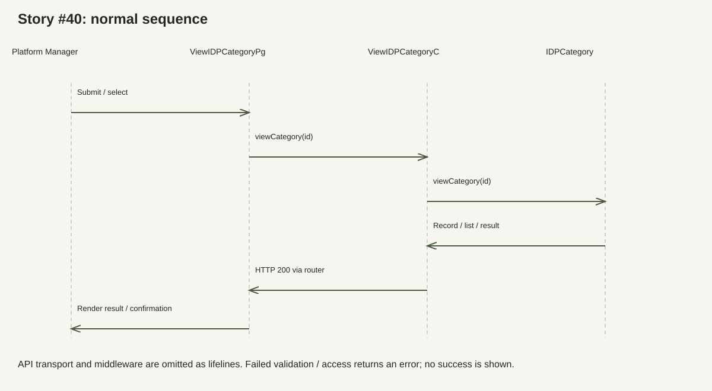

# Story #40: View IDP category

Owner: Christy. Actor: Platform Manager. Sprint 1+2.

Source: uploaded `CSIT314_Project_Plan (1).xlsx`, Story Checklist row 29; Features rows 10–11. These descriptions document the current implementation. Input limits and duplicate handling follow the existing code; they are not new tutor-approved requirements.

## Use case diagram

## Use case description

Goal: view idp category in the Interior Design Platform.

Preconditions: an active account and profile, a valid server session with role `Platform Manager` and an existing selected record.

Trigger: the actor selects view.

### Normal flow

1. The Platform Manager selects View from the search results.
2. The boundary requests the selected ID.
3. The API checks the session and role.
4. The controller validates the ID and the entity reads the record.
5. The boundary displays name and description.

### Alternative flows

- No session: 401; the shared client ends a protected session and the guard opens login.
- Wrong role: 403; no record is changed.
- Database/network failure: show an error and allow retry; do not show success.
- Invalid positive integer ID: 400. Valid ID with no record: 404.

Postcondition: the normal flow completes with HTTP 200; failed validation or access does not apply the requested change. Reads leave data unchanged.

## BCE class diagram

Boundary: `client/src/boundary/ViewIDPCategoryPg.jsx`. Controller: `server/src/controller/ViewIDPCategoryC.js`. Entity: `server/src/entity/IDPCategory.js`.

The BCE diagram shows logical boundary/control/entity roles. Boundaries use React hooks and shared UI components; diagrams do not invent JavaScript classes or methods. Create/update boundaries define `displaySuccess()` and `displayError()`. View/search use `DetailsView`, `ResultsTable` and `RecordLoadState`; confirmation errors are handled by `ConfirmAction`.

## Sequence diagram

API: `GET /api/idp-categories/:id`. The boundary calls `api`, which carries the session cookie and CSRF token. The router invokes `ViewIDPCategoryC.viewCategory(id)`; the controller invokes `IDPCategory.viewCategory(id)`.

## Test cases and automated checks

1. Existing ID → 200 and correct fields.
2. Invalid ID → 400; missing ID → 404.

Access cases for every route: anonymous → 401; another role → 403. Mutation cases: missing/wrong CSRF or untrusted Origin → 403; authorized owner with a valid token → normal flow. See `server/tests/christyAuthorization.test.js` and `server/tests/idpCategories.test.js`.

Manual UI cases still to record: complete the normal flow; preserve values after an error; cancel a confirmation; keyboard-only use and focus restoration; phone-width layout; retry a failed load. Live-site deployment has not been checked in this run.

## Evidence status

The feature code and tests existed before this run. Historical TDD screenshots cannot be reconstructed. This run added and ran 16 authorization integration tests before mounting the feature routers: all 16 failed (404). After integration, the full server suite passed (110 tests). This is integration evidence, not proof that the original feature used TDD.

The Supabase migration is prepared in `docs/christy-schema.sql` and has not been applied. PR merge, remote CI, live deployment and lab evidence remain pending.
